# Stok Yönetim Sistemi
Ceyda Şahin | 24083001 | BGT331 - .NET Programlama I

## Amaç ve özellikler
C# / Windows Forms ile bellekte ürün ve stok yönetimi. Ürün ekleme, listeleme, güncelleme, onaylı silme; stok girişi/çıkışı; kod/ad araması, kategori filtresi, kritik stok filtresi ve güncel özetler içerir. Stok hareketleri ayrı sekmede izlenir. Veritabanı veya kalıcı kayıt kullanılmaz.

## Teknoloji
.NET Framework 4.8, C# 7.3, Windows Forms. Visual Studio 2026 Community MSBuild ile Release derlemesi başarılıdır. Ek NuGet paketi gerekmez. Visual Studio'da .NET masaüstü geliştirme iş yükü ve .NET Framework 4.8 hedefleme paketi bulunmalıdır.

## Açma ve çalıştırma
1. Visual Studio'da `01_SourceCode/24083001_ceydasahin.sln` dosyasını açın. Eski `.slnx` dosyası yerine `.sln` dosyasını kullanın.
2. Başlangıç projesini `24083001_ceydasahin` seçin; Release veya Debug / Any CPU yapılandırmasını kullanın.
3. Çözümü derleyin ve F5 ile çalıştırın.
4. Üstteki yeni ürün alanlarını doldurun. Örneğin P001, Kalem, Kırtasiye, 15, 10 girip Ürün ekle'ye basın.
5. Güncelleme için tablodan satır seçip Güncelle butonuna basın. Açılan pencerede ürün kodu, ürün adı, kategori ve birim fiyatı düzenleyip Kaydet seçin. İptal değişiklikleri kaydetmez; değişiklik yapılmadan Kaydet seçilirse bilgilendirme gösterilir. Stok miktarı stok giriş/çıkış butonlarıyla değiştirilir.
6. Uygulama kapanınca kayıtlar silinir.

## Kaynak düzeni
- Program.cs: başlangıç noktası.
- UrunDuzenleForm.cs: seçili ürünün bilgilerini Kaydet/İptal ile düzenleme penceresi.
- Form1.cs / Form1.Designer.cs: arayüz, olaylar ve kullanıcı mesajları.
- Models/Urun.cs: soyut ürün, kontrollü property ve stok metotları.
- Models/StandartUrun.cs: Urun'den türeyen somut ürün, override edilen durum metodu.
- Models/StokHareketi.cs: zaman, ürün kodu, hareket türü, miktar ve son stok.
- Services/IStokServisi.cs: arayüzün kullandığı servis sözleşmesi.
- Services/StokServisi.cs: benzersiz kod denetimi ve List<T> üzerinden ürün/stok yönetimi.

## OOP örnekleri
Kapsülleme: stok private setter ile korunur; StokGir/StokCik doğrulama yapar.
Kalıtım: StandartUrun : Urun.
Çok biçimlilik: Urun koleksiyonundaki nesnelerin DurumAciklamasi metodu tabloda çağrılır; somut sınıfın override metodu çalışır.
Soyutlama: abstract Urun ve IStokServisi uygulama akışında kullanılır. Form, IStokServisi türündeki alan üzerinden çalışır.
Constructor: Urun, StandartUrun, StokHareketi ve Form1.

## Doğrulama durumu
20.11.2026 tarihinde teslim paketindeki kaynaklar .NET Framework 4.8 Release yapılandırmasında başarıyla derlenmiştir. Otomatik kritik stok hesabı ve ürün kodu güncelleme servis kontrolleri geçmiştir. Uygulama kullanımına ilişkin rapor 03_Report/Proje_Raporu.pdf içindedir.

## Görseller ve rapor
[Proje raporu](03_Report/Proje_Raporu.pdf) ve 15 çalışma ekran görüntüsü bu depoda bulunur.

## GitHub
Repository: https://github.com/ceydasahin0/24083001_CeydaSahin_StokYonetimSistemi

Depo kullanıcının tercihiyle Public durumundadır. Şartnamedeki Private koşulu ve depo adıyla farklılık bulunmaktadır; collaborator ve teslim koşulları ayrıca kontrol edilmelidir.

## Stok girişi kullanımı
Tablodan ürünü seçip Stok girişi düğmesine basın. Açılan pencerede Kaç adet eklenecek? alanına miktarı yazıp Ekle seçin. Yalnızca seçili ürünün stoku yazılan miktar kadar artar. İptal veya pencereyi kapatma stok değiştirmez. Stok çıkışı düğmesi de Kaç adet silinecek? penceresini açar. Girilen miktar Stoktan düş ile stoktan çıkarılır. Mevcut stoktan fazlası reddedilir; İptal stok değiştirmez.

## Otomatik kritik stok
Kritik değer en az 0, en fazla 10'dur. Ürünün ulaştığı en yüksek stokun %20'si yukarı yuvarlanır ve 0–10 aralığında sınırlandırılır. Örneğin en yüksek stok 20 ise kritik değer 4, 100 ise 10, başlangıç stoku 0 ise 0 olur. Bu sınır ürünün stok miktarını kısıtlamaz. Mevcut stok kritik değerin altına düştüğünde ürün kırmızıyla vurgulanır; sıfır stok her zaman Stok yok olarak uyarılır.

## Teslim paketi klasörleri
- 01_SourceCode: Visual Studio çözümü, proje dosyası ve C# kaynakları.
- 02_Application: Release EXE ve uygulama yapılandırması. Çalıştırmak için .NET Framework 4.8 gerekir.
- 03_Report: Proje_Raporu.pdf.
- 04_GitHub: README ve GitHub repository bağlantısı.

GitHub bağlantısı ALMS ZIP tesliminin yerine geçmez.

## İndirilebilir teslim paketi
[24083001_CeydaSahin_InventoryManagement.zip](24083001_CeydaSahin_InventoryManagement.zip)

## Uygulama ekran görüntüleri
Görseller `screenshots/` klasöründedir.

### 1. Ana ekran

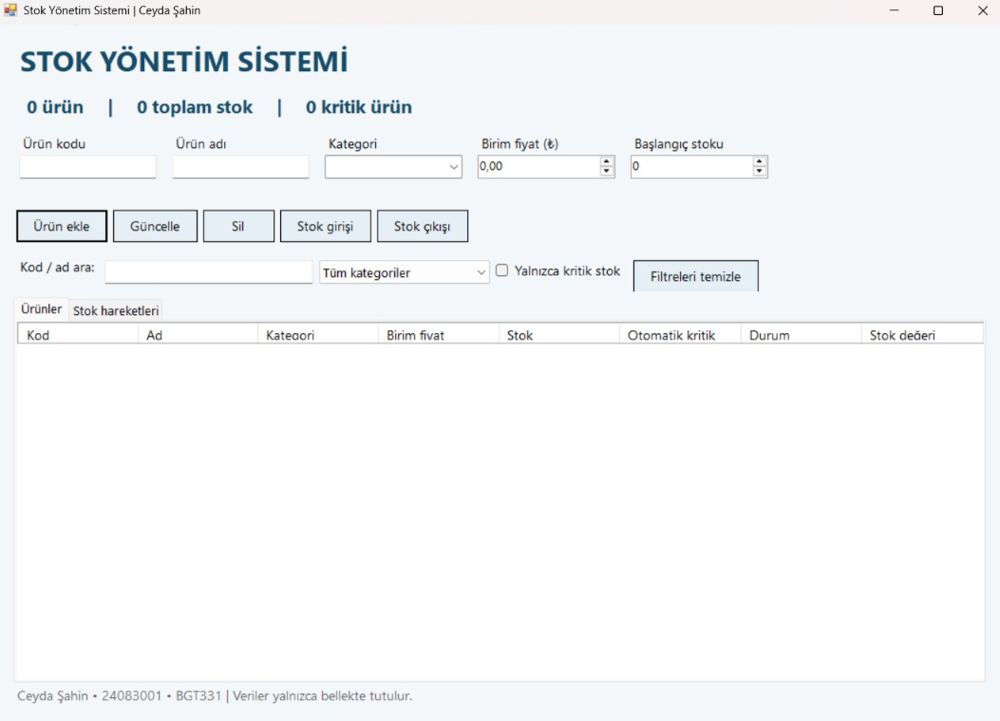

### 2. Ürün adı doğrulaması

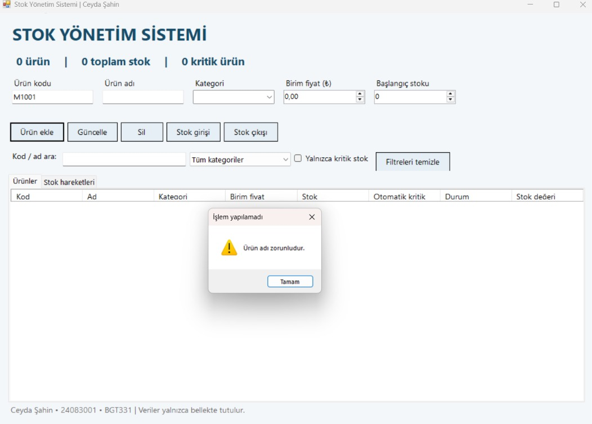

### 3. Ürün kodu doğrulaması

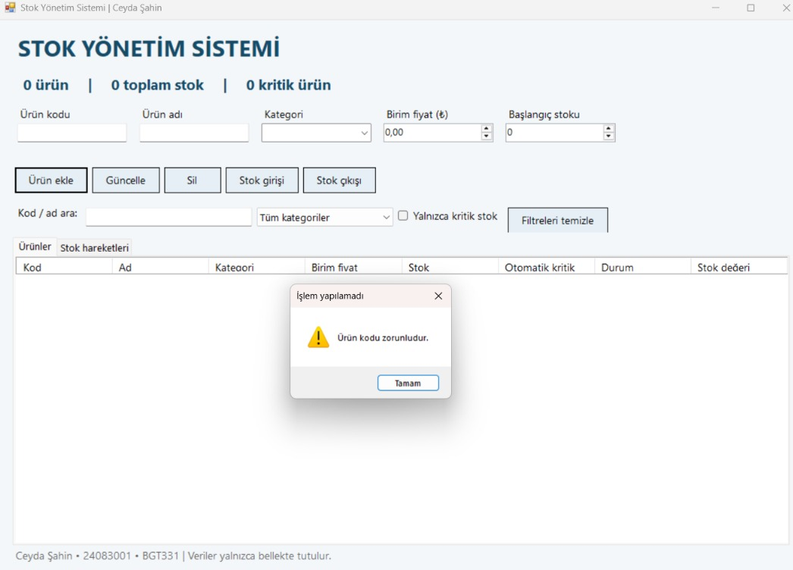

### 4. Ürün seçimi uyarısı

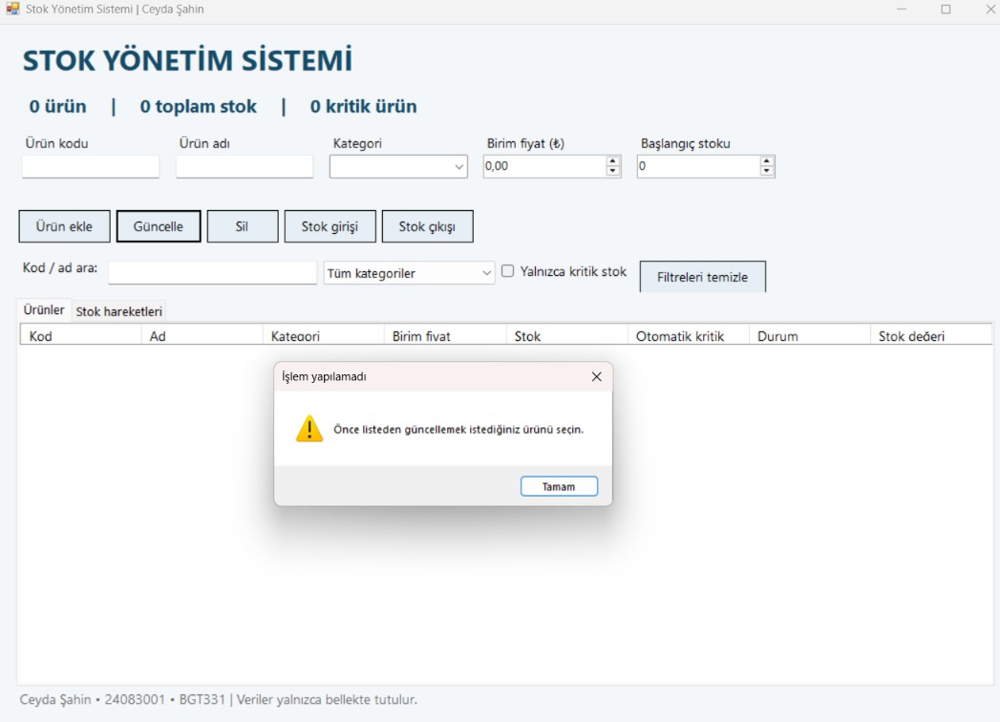

### 5. Ürün ekleme bildirimi

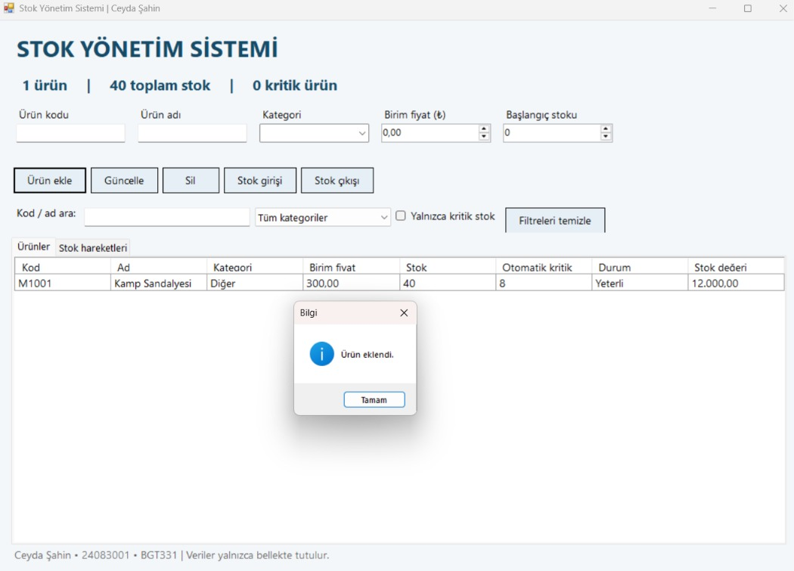

### 6. Kategori seçimi

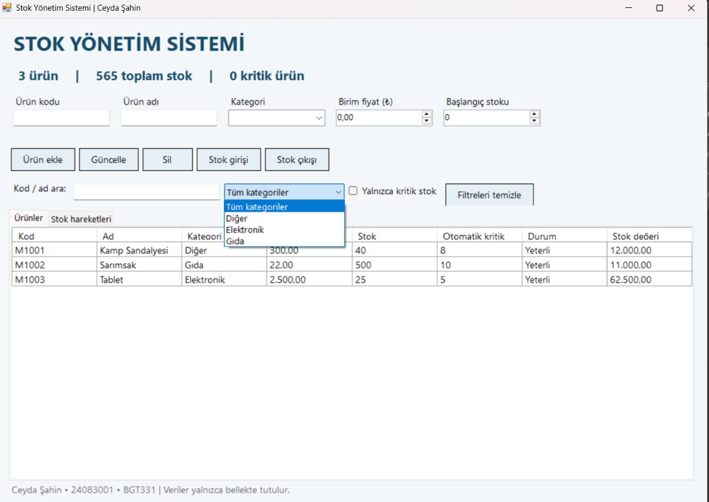

### 7. Kategoriye göre filtreleme

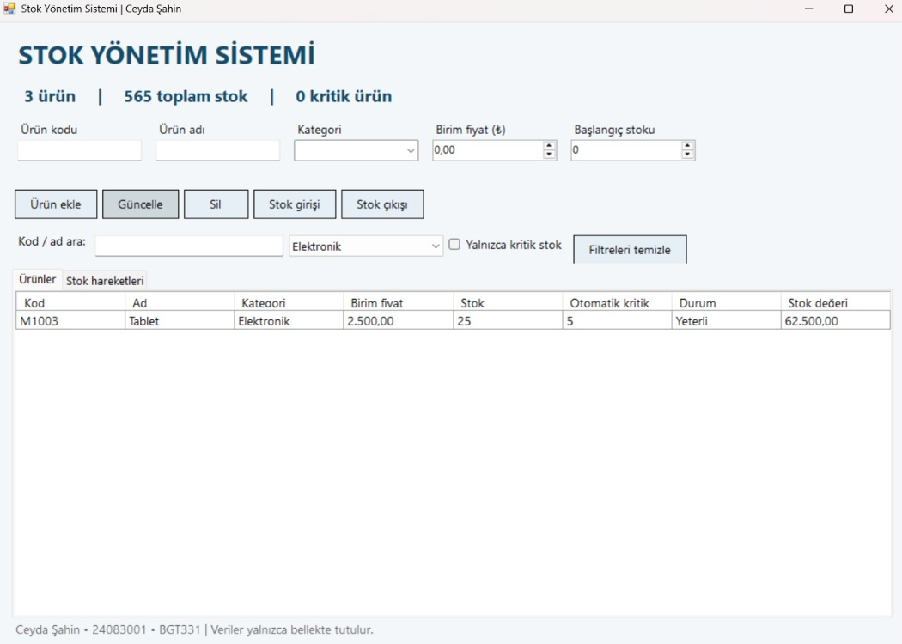

### 8. Ürün koduna göre arama

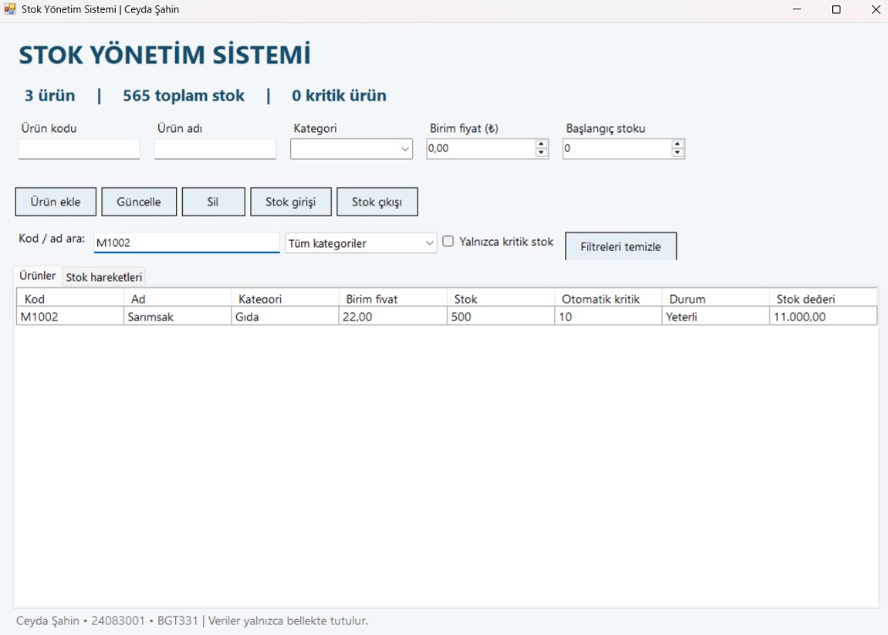

### 9. Stok çıkışı penceresi

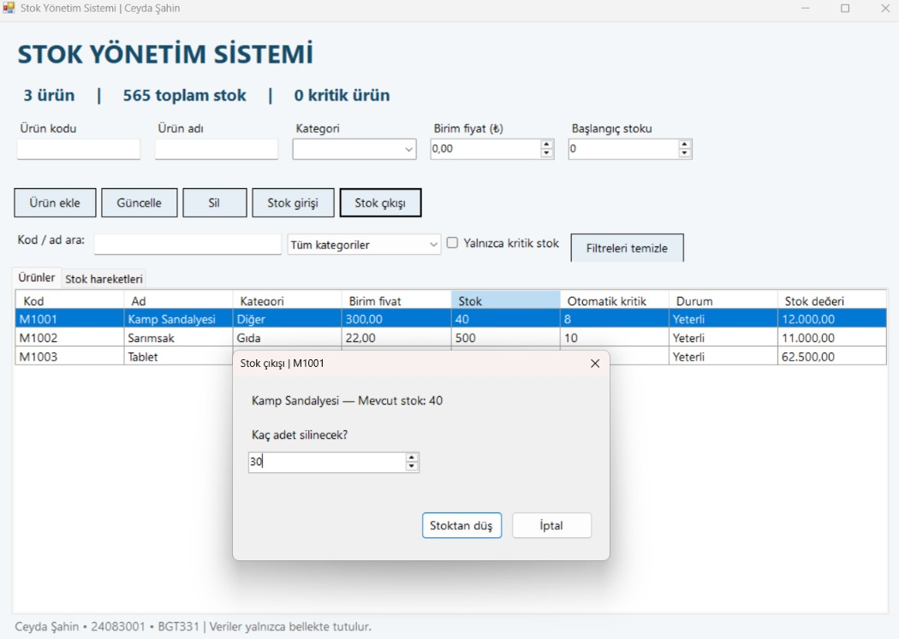

### 10. Stok çıkışı bildirimi

### 11. Stok girişi bildirimi

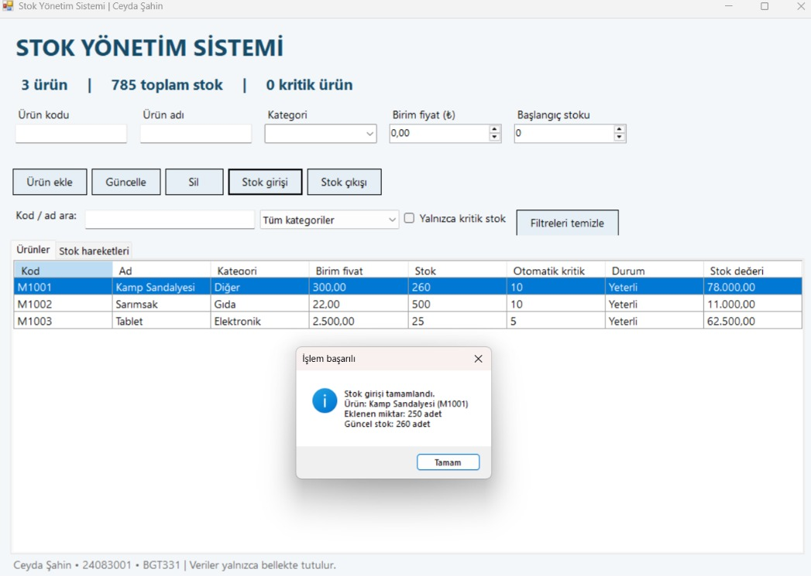

### 12. Ürün güncelleme penceresi

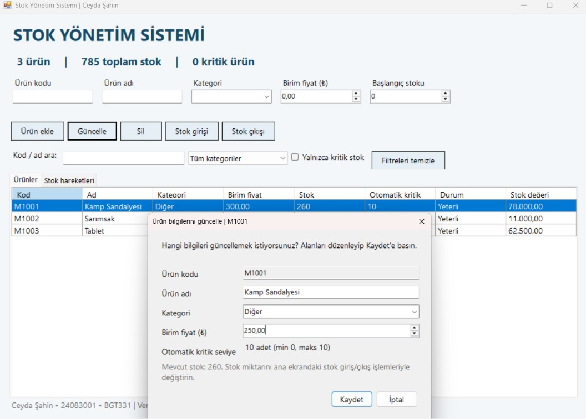

### 13. Güncelleme bildirimi

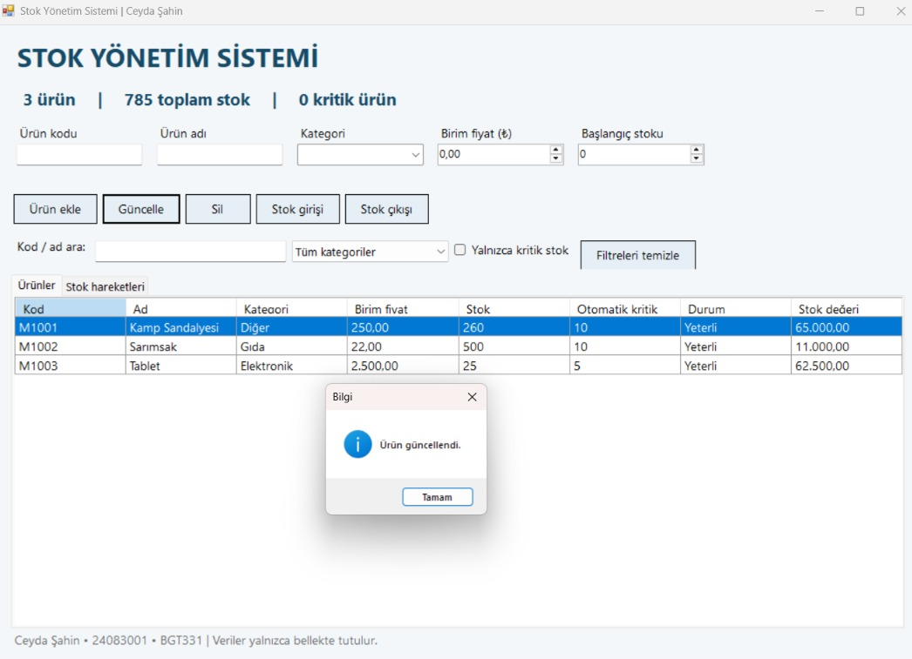

### 14. Yetersiz stok uyarısı

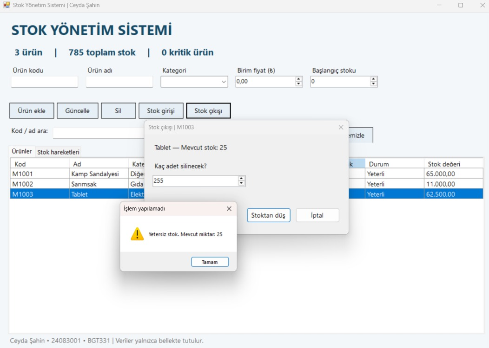

### 15. Stok tükendiğinde ürün görünümü

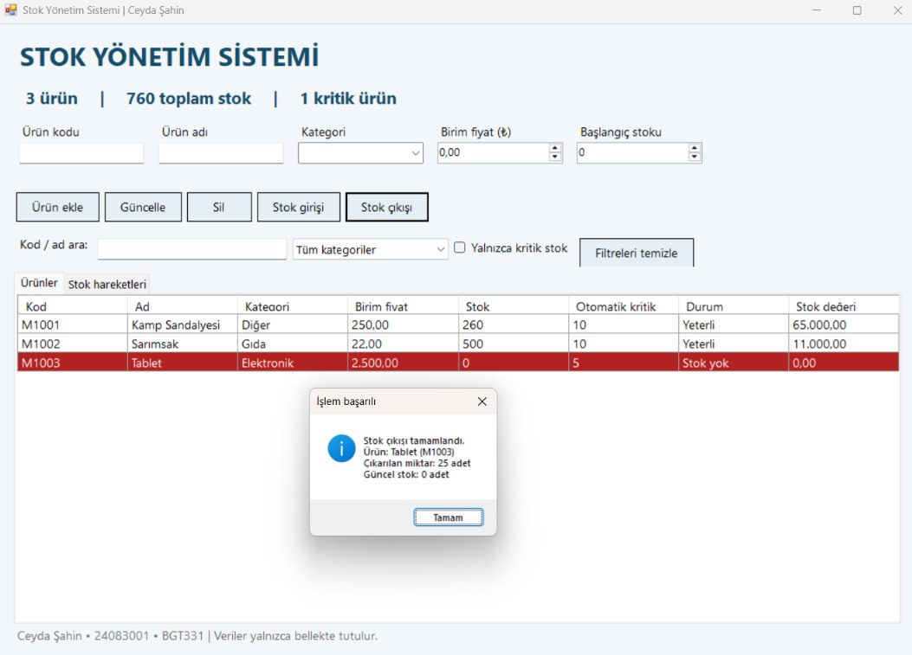
